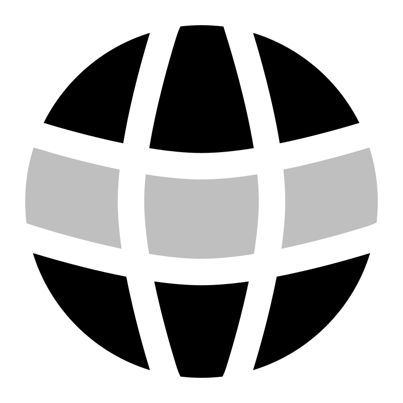
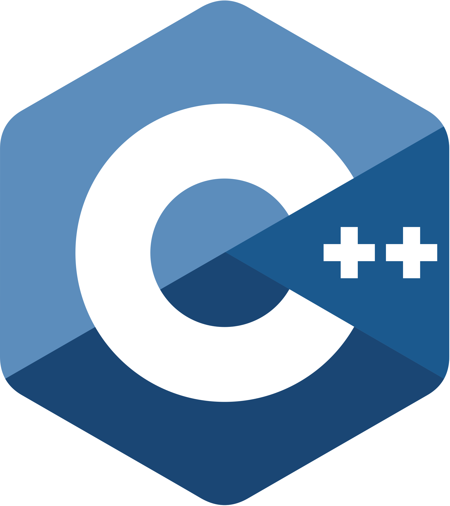
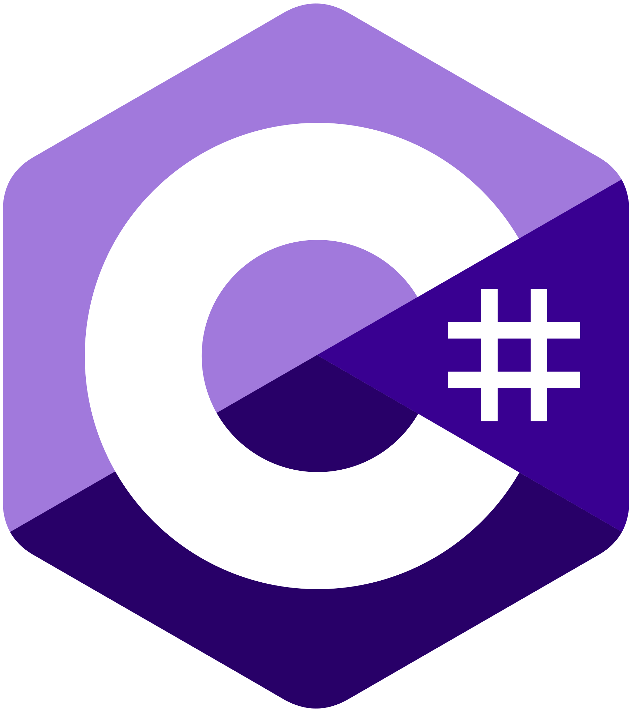
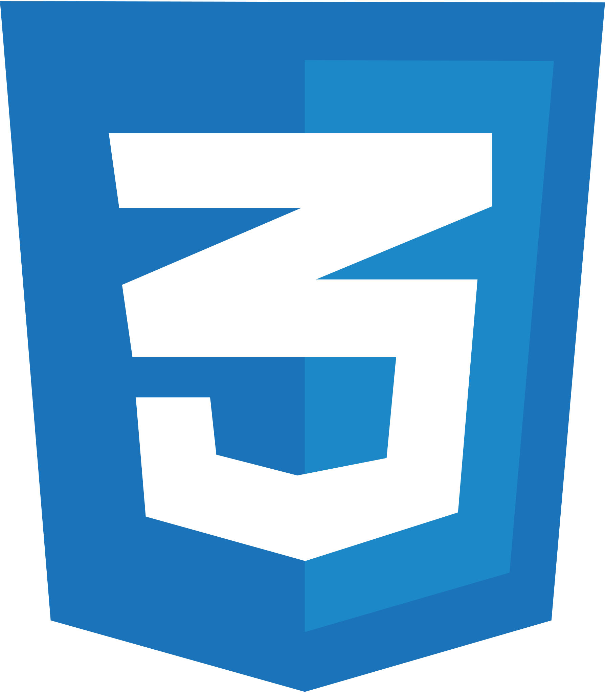
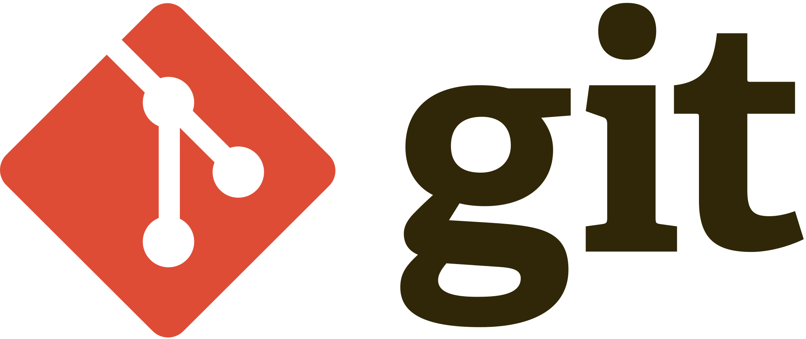
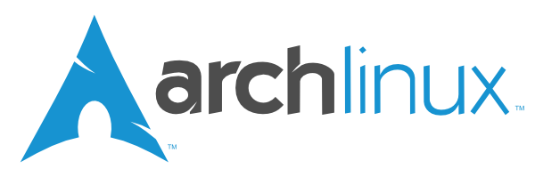
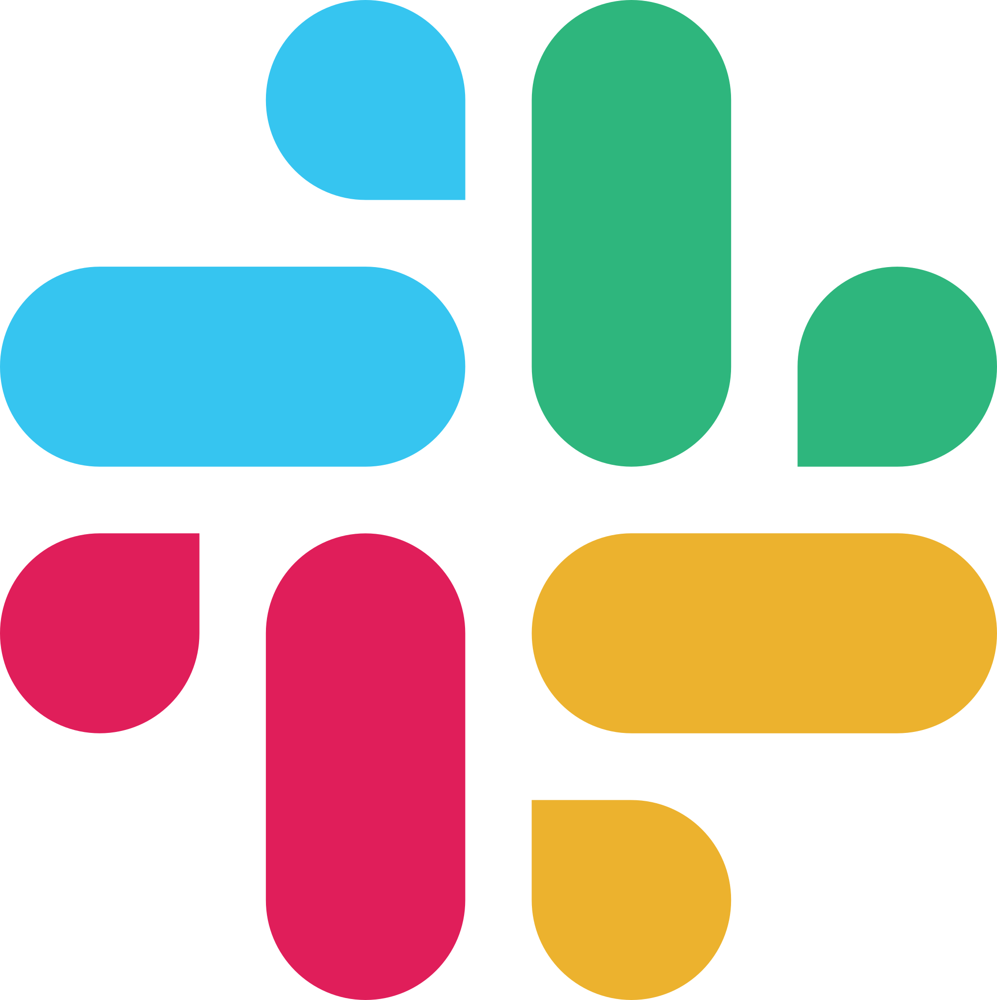

<!-- markdownlint-disable MD045 -->
<!-- markdownlint-disable MD033 -->
<!-- markdownlint-disable MD041 -->

#

<table align="center">
	<tr>
		<td align="center">
			<h2>Ahoy, fellow explorer!</h2>
		</td>
		<td align="center">
			
		</td>
	</tr>
</table>

<table>
	<tr>
		<td>
			<h3>
				👨‍💻 Gideon here, a passionate software engineer and tech enthusiast from Kenya 🇰🇪
			</h3>
		</td>
	</tr>
	<tr>
		<td>
			<h3>
				I'm currently pursuing a Bachelor's degree in Computer Science at Kenyatta University and also a student at <a href="https://www.alxafrica.com" target="_blank">ALX Africa</a>, where I'm honing my skills in software engineering and web development.
				I'm always looking for new opportunities to learn and grow.
			</h3>
		</td>
	</tr>
	<tr>
		<td>
			<h3>
				I have a pretty good understanding of data structures and algorithms, and I'm proficient in C and Java. I'm also familiar with web technologies like HTML, CSS, and JS. I'm currently learning VueJS and NodeJS + ExpressJS to build full-stack PWAs. AI and machine learning are also areas that I'm interested in and would like to explore further.
			</h3>
		</td>
	</tr>
	<tr>
		<td>
			<h3>
				I'm a huge fan of the <a href="https://www.gnu.org/philosophy/free-sw.html" target="_blank">free software movement</a> and believe that software should be free and accessible to everyone. Keeping up and experimenting with the latest tech trends is something I enjoy doing and ensures that I'm always up-to-date with the latest tools and technologies. I active engage in different tech communities to enhance my knowledge and get different perspectives on various topics in tech.
			</h3>
		</td>
	</tr>
	<tr>
		<td>
			<h3>
				When I'm not coding, you'll find me reading, writing, or playing video games. I'm also a huge fan of animations and like to play around with <a href="https://blender.org">blender</a>. I'm always up for a good conversation, so feel free to reach out to me if you want to chat or collaborate on a project.
			</h3>
		</td>
	</tr>
</table>

<table align="center">
	<tr>
		<td align="center">
			
		</td>
		<td align="center">
			
		</td>
		<td align="center">
			
		</td>
		<td align="center">
			
		</td>
		<td align="center">
			
		</td>
		<td align="center">
			
		</td>
	</tr>
	<tr>
		<td align="center">
			
		</td>
		<td align="center">
			
		</td>
		<td align="center">
			
		</td>
		<td align="center">
			
		</td>
		<td align="center">
			
		</td>
		<td align="center">
		</td>
	</tr>
</table>

---

🛠️ MY FAVORITE TOOLS

<table>
	<tr>
		<td colspan="1000" align="center">
			<h2>Programming Languages</h2>
		</td>
	</tr>
	<tr>
		<td>
			
		</td>
		<td>
			
		</td>
		<td>
			
		</td>
		<td>
			
		</td>
		<td>
			
		</td>
	</tr>
	<tr>
		<td colspan="1000" align="center">
			<h2>Web Development</h2>
		</td>
	</tr>
	<tr>
		<td>
			
		</td>
		<td>
			
		</td>
		<td>
			
		</td>
		<td>
			
		</td>
	</tr>
	<tr>
		<td colspan="1000" align="center">
			<h3>🧰 Frameworks and Libraries</h3>
		</td>
	</tr>
	<tr>
		<td>
			
		</td>
		<td>
			
		</td>
		<td>
			
		</td>
		<td>
			
		</td>
			<td>
			
		</td>
	</tr>
</table>

---

<table align="center">
	<tr>
		<td align="center">
			<b>
				Top languages is only a metric of the languages my public code consists of and doesn't reflect experience or skill level.
			</b>
		</td>
	</tr>
</table>

STATS

  
  

---

<table align="center">
	<tr>
		<td align="center">
			
		</td>
	</tr>
</table>

---

<table align="center">
	<tr>
		<td align="center">
			
		</td>
		<td align="center">
			
		</td>
		<td align="center">
			
		</td>
		<td align="center">
			
		</td>
	</tr>
</table>

#############################################################
<!-- markdownlint-disable MD033 -->

<!--

    

-->

   <!--  -->
    

---

    <h2>
        Ahoy, fellow explorer 🌐  As a passionate student of computer scientist, I am on an epic quest to
 evolve into a formidable full-stack developer capable of crafting innovative solutions for web, mobile, and desktop platforms. I am also delving into the depths of AI/ML, exploring their potential to reshape our digital landscape and committed to the noble cause of cybersecurity.
    </h2>
    <!--  -->

    <h2>
        Driven by a passion for tech, I embrace challenges with a mindset fueled by innovation and collaboration, valuing the principles of open source, innovation, and continuous learning.
    </h2>

<!--

    <h4>
        #CIsFun    #LearnJava    #AI/ML    #ObjectOrientedObsession    #FullStackDeveloperInProgress
        #WebDev    #ArchLinux    #ShellScripting    #DoHardThings    #HackThePlanet
    </h4>

-->

---

    
    
    
    

    
    
    
    
    

---

<!--

    <h2 align="center style="color: #ff25;">::SKILL SET::</h2>
    

    

    

     

-->

  <h3>👨‍💻 Programming Languages</h3>

  <h3>🌐 Web Development</h3>

  <h3>🧰 Frameworks and Libraries</h3>

<a href="#">
  

  <h3>Scripting Languages</h3>

  <h3>🗄️ Databases and Cloud Hosting</h3>

  <h3>Dev Ops</h3>

  <h3>💻 Software and Tools</h3>

  
<h2>🛠️ My Favorite Tools</h2>

  <!-- Some badges are from https://github.com/Ileriayo/markdown-badges -->

  <h3>👨‍💻 Programming and Markup Languages</h3>

  

      
      
      
      
      
      
      
      
      
      
      
      
      
      
      
      
      
      
      
      
      
  

  <h3>🧰 Frameworks and Libraries</h3>

  

      
      
      
      
      
      
      
      
      
      
      
      
      
      
      
      
      
      
      
      
      
      
      
      
      
  

  <h3>🗄️ Databases and Cloud Hosting</h3>

  

      
      
      
      
      
      
      
      
      
      
      
  

  <h3>💻 Software and Tools</h3>

  

      
      
      
      
      
      
      
      
      
      
      
      
      
      
      
      
      
      
      
      
      
      
  

<!--
**Cloud Services:**

**Programming Languages:**

**Tools and Services:**

-->

<!--

<h2  style="color: #ff25;">SKILL : : SET</h2>
<h2  style="color: #ff25;">WEB</h2>
<h3 align="center"  style="color: #ff5;"> Frontend </h3>

<h3 align="center" style="color: #ff5;"> Backend</h3>

<h3 align="center" style="color: #ff5;">🧰 Frameworks & Libraries</h3>

    <h2  style="color: #ff25;">🗄️ DATABASES : : CLOUD : : HOSTING</h2>
    

    <h2  style="color: #ff25;">💻 SOFTWARES : : TOOLS</h2>
    

    <h2  style="color: #ff25;">👨‍💻 LANGUAGES</h2>
    

-->

---

<!--
<h3 align="center">
    
</h3>

    

    

    

    

-->

<!--🏆TROPHYGIF-->
<!---->

<!--## MY :🏆: TROPHIES-->

<!--https://github.com/ryo-ma/github-profile-trophy-->

    

    
    
    
    

---

<!--

    
    

-->
<!--

    

-->

<!-- ######################################################################### -->
<!-- markdownlint-disable MD033 -->
#

   

---

> ## Ahoy, fellow explorer 🌐 
>
> ## As a passionate student of computer scientist, I am on an epic quest to evolve into a formidable full-stack developer capable of crafting innovative solutions for web, mobile, and desktop platforms. I am also delving into the depths of AI/ML, exploring their potential to reshape our digital landscape and committed to the noble cause of cybersecurity
>
> ## Driven by a passion for tech, I embrace challenges with a mindset fueled by innovation and collaboration, valuing the principles of open source, innovation, and continuous learning

---

<!-- <h2 align="center">: : Let's 📬 Get In Touch ✉️ Reach Out : :</h2>-->

   
   
    
    
    
    
    
    
    

---

  <!-- Some badges are from https://github.com/Ileriayo/markdown-badges -->
  

        <!--<h3>👨‍💻 Programming and Markup Languages</h3>-->
        
        
        
        <!--  -->
        
        
        
        
        
        
  

  

        <!--<h3>🧰 Frameworks and Libraries</h3>-->
        
  

  

        <!--<h3>🗄️ Databases and Cloud Hosting</h3>-->
        
        
        
        
        
  

  

        <!--<h3>💻 Software and Tools</h3>-->
        <a href="#">
                
                
                
                
                
                
               
        </a>
  

> <!--<h2 align="center">: : 💻 GitHub Profile Stats : :</h2>-->

        <!-- GitHub Readme Streak Stats - https://github.com/DenverCoder1/github-readme-streak-stats -->
        <a href="https://github.com/DenverCoder1/github-readme-streak-stats">
                <!-- Use https://streak-stats.demolab.com or self-host with your own Vercel app - visit https://git.io/streak-stats for instructions -->
                <!--  -->

                <!-- https://github.com/anuraghazra/github-readme-stats -->
                <!-- <a href="https://github.com/anuraghazra/github-readme-stats"> -->
                
                <!-- <a href="https://github.com/anuraghazra/github-readme-stats"> -->
                
                <!-- https://github.com/ashutosh00710/github-readme-activity-graph -->
                
        </a>
  
 <b>Note:</b> Top languages is only a metric of the languages my public code consists of and doesn't reflect experience or skill level.

<!--## MY :🏆: TROPHIES-->
<!--https://github.com/ryo-ma/github-profile-trophy-->
 

        

---

        
        
        

<!-- 

    

 -->

---

---

---

<!-- markdownlint-enable MD033 -->

<h1 align="center">Hi , I'm  Gideon-Yebei</h1>

<h2 align="center">Software Engineer And AI/ML Enthusiast and Explorer</h2>

#  About Me
- 🎓 I am a Computer Science student at [Jomo Kenyatta University of Agriculture and Technology](https://www.jkuat.ac.ke/)
- 🌱 I’m currently learning Machine Learning and Artificial Intelligence
- 👯 I’m looking to collaborate on Machine Learning and Artificial Intelligence projects
- 💬 Ask me about Python, Machine Learning, and Artificial Intelligence
- 📫 How to reach me: [Email](mailto:
- 😄 Pronouns: He/Him
- ⚡ Fun fact: I love playing chess and watching movies
- 📝 [Resume](https://drive.google.com/file/d/1J9Q6J9Q6J9Q6J9Q6J9Q6J9Q6J9Q6J9Q6/view?usp=sharing)
- 📝 [Portfolio](https://gideon-yebei.github.io/)
- 📝 [LinkedIn](https://www.linkedin.com/in/gideon-yebei-7b0b3b1b3/)

#  Tech Stack

## Languages
&nbsp;
&nbsp;
&nbsp;
&nbsp;
&nbsp;
&nbsp;

## Libraries and Frameworks
&nbsp;
&nbsp;
&nbsp;
&nbsp;
&nbsp;
&nbsp;
&nbsp;
&nbsp;
&nbsp;
&nbsp;
&nbsp;

## Databases
&nbsp;
&nbsp;
&nbsp;

## Tools
&nbsp;
&nbsp;
&nbsp;
&nbsp;
&nbsp;
&nbsp;
&nbsp;
&nbsp;
&nbsp;

## Operating Systems
&nbsp;
&nbsp;

#  GitHub Stats

#  Random Dev Quote

#  About Me:
 I’m currently working on open-source.  I’m looking to collaborate on Python-related work.  I’m looking for help with java.   I’m currently doing Btech in CSE. 💬 Ask me about Python and SQL.

##  Socials:
 

#  Tech Stack:
          

#   GitHub Stats:

 

#  Holopin Badges:

 

###  Random Dev Quote

****