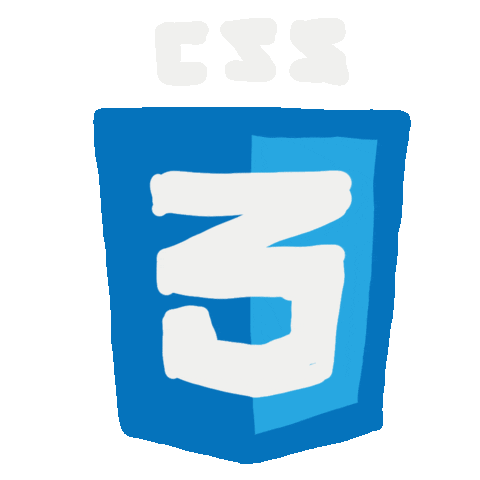
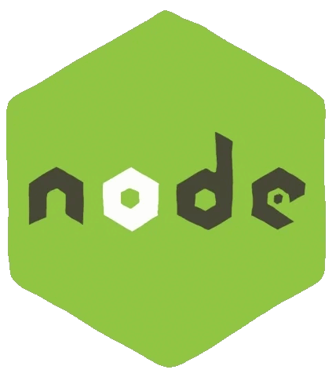

Hi there 👋, Aliens 👽

<!--
<h1 align="center">
    ᕼᎥ
    ,
    Ꭵ'ᗰ ǤᎥᗪᗴᗝᑎ-ƳᗴᗷᗴᎥ
</h1>

<h2 align="center">
    𝕊𝕠𝕗𝕥𝕨𝕒𝕣𝕖 𝔼𝕟𝕘𝕚𝕟𝕖𝕖𝕣, 𝔸𝕀/𝕄𝕃 𝔼𝕟𝕥𝕙𝕦𝕤𝕚𝕒𝕤𝕥 𝕒𝕟𝕕 𝔼𝕩𝕡𝕝𝕠𝕣𝕖𝕣
</h2>

---

<h1 align="center">ℂ𝕠𝕟𝕟𝕖𝕔𝕥 𝕆𝕟</h1>

    
  
    
    
    

---

<h1 align="center">
    
    𝔸𝕓𝕚𝕥 𝔸𝕓𝕠𝕦𝕥 𝕄𝕪𝕤𝕖𝕝𝕗
</h1>

𝕀'𝕞 𝕤𝕦𝕡𝕖𝕣 𝕚𝕟𝕥𝕠 𝕤𝕠𝕗𝕥𝕨𝕒𝕣𝕖 𝕖𝕟𝕘𝕚𝕟𝕖𝕖𝕣𝕚𝕟𝕘 𝕒𝕟𝕕 𝕝𝕠𝕧𝕖𝕤 𝕕𝕚𝕧𝕚𝕟𝕘 𝕚𝕟𝕥𝕠 𝕤𝕥𝕦𝕗𝕗 𝕝𝕚𝕜𝕖 𝔻𝕒𝕥𝕒 𝕊𝕔𝕚𝕖𝕟𝕔𝕖, 𝔸𝕀 & 𝕄𝕃 𝕒𝕟𝕕 𝕖𝕩𝕡𝕝𝕠𝕣𝕚𝕟𝕘 𝕥𝕙𝕖 𝕝𝕒𝕥𝕖𝕤𝕥 𝕥𝕖𝕔𝕙 𝕥𝕣𝕖𝕟𝕕𝕤. 𝕆𝕣𝕚𝕘𝕚𝕟𝕒𝕝𝕝𝕪 𝕗𝕣𝕠𝕞 ℕ𝕒𝕚𝕣𝕠𝕓𝕚, 𝕂𝕖𝕟𝕪𝕒, 𝕀'𝕞 𝕒𝕝𝕝 𝕒𝕓𝕠𝕦𝕥 𝕦𝕤𝕚𝕟𝕘 𝕥𝕖𝕔𝕙 𝕥𝕠 𝕥𝕒𝕔𝕜𝕝𝕖 𝕓𝕚𝕘 𝕔𝕙𝕒𝕝𝕝𝕖𝕟𝕘𝕖𝕤. 𝕀'𝕞 𝔼𝕩𝕔𝕚𝕥𝕖𝕕 𝕥𝕠 𝕔𝕠𝕟𝕥𝕣𝕚𝕓𝕦𝕥𝕖 𝕒𝕟𝕕 𝕔𝕠𝕝𝕝𝕒𝕓𝕠𝕣𝕒𝕥𝕖 𝕠𝕟 𝕡𝕣𝕠𝕛𝕖𝕔𝕥𝕤 𝕒𝕟𝕕 𝕔𝕒𝕟'𝕥 𝕨𝕒𝕚𝕥 𝕥𝕠 𝕓𝕣𝕚𝕟𝕘 𝕞𝕪 𝕤𝕜𝕚𝕝𝕝𝕤 𝕥𝕠 𝕥𝕙𝕖 𝕥𝕒𝕓𝕝𝕖 𝕚𝕟 𝕥𝕙𝕖 𝕥𝕖𝕔𝕙 𝕚𝕟𝕕𝕦𝕤𝕥𝕣𝕪!

---

<h1 align="center">
    
    𝕋𝕖𝕔𝕙 𝕊𝕥𝕒𝕔𝕜
</h1>

    
    
    
    
    
    
    
    
    
    
    

---

<h1 align="center">
    
    ℝ𝕒𝕟𝕕𝕠𝕞 𝔻𝕖𝕧 ℚ𝕦𝕠𝕥𝕖𝕤
</h1>

    

    <a href="https://www.cakeresume.com/calcare-spellbound">Resume</a>

---

    𝕋𝕙𝕒𝕟𝕜 𝕪𝕠𝕦 𝕗𝕠𝕣 𝕧𝕚𝕤𝕚𝕥𝕚𝕟𝕘 𝕞𝕪 𝕡𝕣𝕠𝕗𝕚𝕝𝕖! 🤗. 𝕙𝕒𝕧𝕖 𝕒 𝕘𝕣𝕖𝕒𝕥 𝕕𝕒𝕪! 🌟

---

<table>
  <tr>
    <td align="center">
      
    </td>
    <td align="center">
      
    </td>
    <td align="center">
      
    </td>
    <td align="center">
      
    </td>
    <td align="center">
      
    </td>
    <td align="center">
      
    </td>
    <td align="center">
      
    </td>
    <td align="center">
      
    </td>
    <td align="center">
      
    </td>
    <td align="center">
      
    </td>
    <td align="center">
      
    </td>
    <td align="center">
      
    </td>
  </tr>
</table>

---
-->
