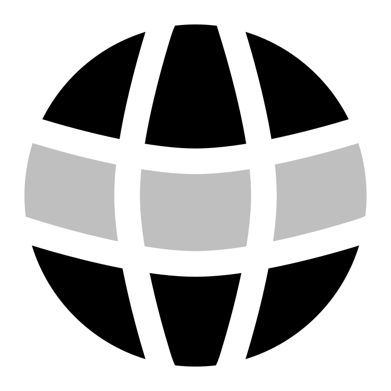

<!-- markdownlint-disable MD045 -->
<!-- markdownlint-disable MD033 -->
<!-- markdownlint-disable MD041 -->

#

<table align="center">
	<tr>
		<td align="center">
			<h2>Ahoy, fellow explorer!</h2>
		</td>
		<td align="center">
			
		</td>
	</tr>
</table>

<table>
	<tr>
		<td>
			<h3>
				👨‍💻 Gideon here, a passionate software engineer and tech enthusiast from Kenya 🇰🇪
			</h3>
		</td>
	</tr>
	<tr>
		<td>
			<h3>
				I'm currently pursuing a Bachelor's degree in Computer Science at Kenyatta University and also a student at <a href="https://www.alxafrica.com" target="_blank">ALX Africa</a>, where I'm honing my skills in software engineering and web development.
				I'm always looking for new opportunities to learn and grow.
			</h3>
		</td>
	</tr>
	<tr>
		<td>
			<h3>
				I have a pretty good understanding of data structures and algorithms, and I'm proficient in C and Java. I'm also familiar with web technologies like HTML, CSS, and JS. I'm currently learning VueJS and NodeJS + ExpressJS to build full-stack PWAs. AI and machine learning are also areas that I'm interested in and would like to explore further.
			</h3>
		</td>
	</tr>
	<tr>
		<td>
			<h3>
				I'm a huge fan of the <a href="https://www.gnu.org/philosophy/free-sw.html" target="_blank">free software movement</a> and believe that software should be free and accessible to everyone. Keeping up and experimenting with the latest tech trends is something I enjoy doing and ensures that I'm always up-to-date with the latest tools and technologies. I active engage in different tech communities to enhance my knowledge and get different perspectives on various topics in tech.
			</h3>
		</td>
	</tr>
	<tr>
		<td>
			<h3>
				When I'm not coding, you'll find me reading, writing, or playing video games. I'm also a huge fan of animations and like to play around with <a href="https://blender.org">blender</a>. I'm always up for a good conversation, so feel free to reach out to me if you want to chat or collaborate on a project.
			</h3>
		</td>
	</tr>
</table>

<table align="center">
	<tr>
		<td align="center">
			
		</td>
		<td align="center">
			
		</td>
		<td align="center">
			
		</td>
		<td align="center">
			
		</td>
		<td align="center">
			
		</td>
		<td align="center">
			
		</td>
	</tr>
	<tr>
		<td align="center">
			
		</td>
		<td align="center">
			
		</td>
		<td align="center">
			
		</td>
		<td align="center">
			
		</td>
		<td align="center">
			
		</td>
		<td align="center">
		</td>
	</tr>
</table>

---

🛠️ MY FAVORITE TOOLS

<table>
	<tr>
		<td colspan="5" align="center">
			<h2>Programming Languages</h2>
		</td>
	</tr>
	<tr>
		<td>
			
		</td>
		<td>
			
		</td>
		<td>
			
		</td>
		<td>
			
		</td>
	</tr>
	<tr>
		<td colspan="4" align="center">
			<h2>Web Development</h2>
		</td>
	</tr>
	<tr>
		<td>
			
		</td>
		<td>
			
		</td>
		<td>
			
		</td>
		<td>
			
		</td>
	</tr>
	<tr>
		<td colspan="4" align="center">
			<h3>🧰 Frameworks and Libraries</h3>
		</td>
	</tr>
	<tr>
		<td>
			
		</td>
		<td>
			
		</td>
		<td>
			
		</td>
		<td>
			
		</td>
			<td>
			
		</td>
	</tr>
	<!-- Add the rest of your sections in the same way -->
</table>

---

<table align="center">
	<tr>
		<td align="center">
			<b>
				Top languages is only a metric of the languages my public code consists of and doesn't reflect experience or skill level.
			</b>
		</td>
	</tr>
</table>

STATS

---

<table align="center">
	<tr>
		<td align="center">
			
		</td>
	</tr>
</table>

---

<table align="center">
	<tr>
		<td align="center">
			
		</td>
		<td align="center">
			
		</td>
		<td align="center">
			
		</td>
		<td align="center">
			
		</td>
	</tr>
</table>

